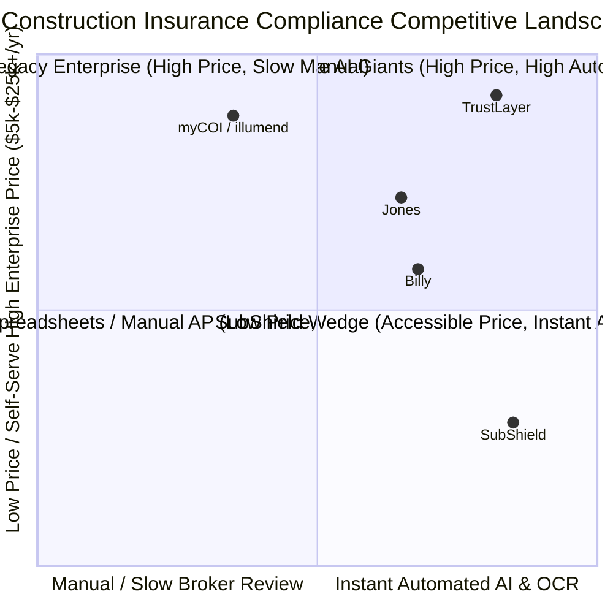

# SubShield Competitive Landscape & Strategic Positioning Matrix

**Date:** November 24, 2026  
**Audience:** Technical Product Management & Executive Strategy  
**Focus:** US Insurance Compliance SaaS Market Competitors  

---

## 1. Primary US Competitor Analysis

---

### Competitor 1: myCOI (Now rebranding to illumend)
* **Headquarters:** Indianapolis, IN (Founded 2009).
* **Target Audience:** Large commercial enterprises, healthcare systems, mega GCs ($100M+ volume).
* **Pricing Model:** Custom enterprise quotes only; minimum contracts start at **$6,000 to $25,000+/year** with multi-year commitments and mandatory implementation fees ($2,500+).
* **Core Strengths:** Deep insurance industry veteran team; high human review accuracy; established brand name.
* **Weaknesses & Complaints:**
  - **Legacy, Clunky User Interface:** Slow, multi-screen navigation requiring extensive user training.
  - **Slow Turnaround:** Subcontractors wait **24 to 48 hours** for myCOI's human teams to verify certificates, stalling jobsite starts.
  - **Extreme Price Barrier:** Unaffordable for small-to-midsize contractors (<$50M volume).
  - **Zero Self-Serve Onboarding:** Mandatory 4-week sales-demo-implementation cycle.

---

### Competitor 2: TrustLayer
* **Headquarters:** San Francisco, CA (Backed by BrokerTech Ventures & top US insurance brokerages).
* **Target Audience:** Enterprise contractors, insurance brokerages, logistics, and supply chain.
* **Pricing Model:** Annual subscription starting at **$8,000 to $30,000+/year**.
* **Core Strengths:** Modern AI document extraction; institutional partnerships with brokerages like Marsh and Holmes Murphy; robotic process automation.
* **Weaknesses & Complaints:**
  - **AI Hallucinations on Complex Endorsements:** Occasional false positives on nuanced multi-state endorsement forms.
  - **Heavy Integration Overhead:** Requires IT involvement to sync with ERP systems.
  - **No Pre-Award Audit Wedge:** Cannot quickly audit 5 sub certificates during a bid without adding them as full enterprise assets.

---

### Competitor 3: Jones (getjones.com)
* **Headquarters:** New York, NY.
* **Target Audience:** Commercial Real Estate (CRE), property managers, and select commercial GCs.
* **Pricing Model:** Tiered annual contracts from **$3,000 to $12,000+/year**.
* **Core Strengths:** Guaranteed 6-hour review turnaround; clean UI; strong integrations with building management systems (MRI, Yardi).
* **Weaknesses & Complaints:**
  - **Real Estate Focus, Not Construction:** Lacks construction-specific deep endorsements (CG 20 37 completed operations, per-project aggregate CG 25 03, statutory workers' comp monopolistic rules).
  - **Rigid Review Rules:** Rejects certificates for minor formatting discrepancies that are commercially acceptable on jobsites.

---

### Competitor 4: Billy (billyforconstruction.com)
* **Headquarters:** Austin, TX / Los Angeles, CA.
* **Target Audience:** Mid-market General Contractors using Procore.
* **Pricing Model:** Tiered pricing starting around **$250 to $600/month**.
* **Core Strengths:** Purpose-built for Procore; streamlined broker email workflows; modern construction-first UX.
* **Weaknesses & Complaints:**
  - **Procore Dependency:** Highly coupled with Procore; weaker standalone value for contractors using QuickBooks, CMiC, or Buildertrend.
  - **Limited Self-Service Instant Audit:** Lacks an instant public self-serve tool for auditing subcontractors prior to contract signing.

---

## 2. Head-to-Head Feature Comparison Matrix

| Capability / Metric | myCOI / illumend | TrustLayer | Jones | Billy | SubShield (Our Platform) |
| :--- | :--- | :--- | :--- | :--- | :--- |
| **Instant Self-Serve Onboarding** | ❌ No | ❌ No | ❌ No | ❌ No | **✅ Yes (Instant Starter Plan)** |
| **Pricing Transparency** | ❌ Hidden ($8k+) | ❌ Hidden ($10k+) | ❌ Hidden ($3k+) | ⚠️ Partial | **✅ 100% Transparent ($199/mo)** |
| **Free 5-COI Audit Wedge** | ❌ No | ❌ No | ❌ No | ❌ No | **✅ Yes (2-Hour PDF Audit)** |
| **Confidence-Scored OCR** | ⚠️ Internal only | ✅ Yes | ⚠️ Hybrid | ⚠️ Basic | **✅ Line-by-Line with Scores** |
| **Human Review Mandate Queue**| ✅ Yes (Slow) | ⚠️ Automated | ✅ Yes (6hr) | ⚠️ Partial | **✅ Rule-Gated Underwriter Queue** |
| **QuickBooks AP Payment Hold** | ⚠️ Custom API | ⚠️ Custom API | ❌ No | ⚠️ Via Procore | **✅ Native AP Freeze Rules** |
| **Broker Magic Upload Links** | ❌ Portal Login | ⚠️ Email flow | ⚠️ Portal Login | ✅ Yes | **✅ Zero-Login Tokenized Links** |
| **Payment Options** | Annual Check/Wire | Annual Invoicing | Annual Invoicing| Credit Card/ACH| **✅ Stripe Card, ACH & Crypto** |
| **Setup Time** | 4 – 6 Weeks | 2 – 4 Weeks | 1 – 2 Weeks | 3 – 5 Days | **< 10 Minutes** |

---

## 3. SubShield’s Asymmetric Market Positioning & Wedge Strategy

### The "Trojan Horse" Wedge
Competitors force General Contractors into 30-minute sales discovery calls, lengthy security reviews, and $10,000 annual commitments before verifying a single document.

**SubShield’s Winning Asymmetric Advantage:**
1. **The Free 5-Certificate Risk Assessment:** We offer GCs an immediate, zero-commitment audit of their 5 most active subcontractors.
2. **Instant Exposure Shock:** When our ReportLab engine reveals **$1.25M in uninsured completed operations gaps**, the GC is immediately sold.
3. **Frictionless Starter Pricing:** At **$199/month**, a project manager or risk officer can expense the cost on a corporate credit card without requiring CFO board approval.
4. **Broker Magic Links:** Brokers love SubShield because they don't have to create passwords or create accounts — they click an authenticated magic link in an email, upload the renewed ACORD PDF, and compliance is updated in seconds.
