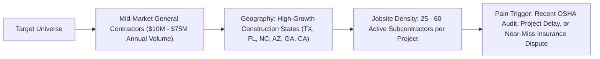

# SubShield US Customer Acquisition & Go-To-Market Playbook

**Author:** B2B SaaS Growth Strategist & Construction Tech Specialist  
**Target Audience:** US Commercial General Contractors & Trade Subcontractor Managers  
**Revenue Target:** First 10 Paying US Contractors ($1,990/mo MRR) in 30 Days  

---

## 1. Ideal Customer Profile (ICP) & Targeting Criteria

* **Company Size:** 15 – 80 employees; managing 3 – 12 active commercial/multifamily jobsites.
* **Key Decision Maker:** VP of Operations, Chief Risk Officer, Project Executive, Controller.
* **Daily End User:** Project Managers, AP / Compliance Coordinators.
* **Technology Profile:** Users of Procore, PlanGrid, QuickBooks Online, Buildertrend, or Excel spreadsheets.

---

## 2. Three Battle-Tested Cold Email Templates

### Template 1: The "Trojan Horse Free 5-COI Audit" (Highest Conversion)
**Subject:** Question regarding {{Company_Name}}'s completed operations endorsements on {{Project_City}} jobs

> Hi {{First_Name}},
>
> In reviewing active commercial project filings in {{Project_City}}, we noticed most mid-market GCs are exposed to a major insurance blind spot: over 65% of subcontractor ACORD 25 certificates check the *Additional Insured* box for ongoing operations, but completely omit the mandatory **CG 20 37 endorsement (Completed Operations)**.
>
> If a structural failure, water intrusion, or trade defect occurs 18 months post-handover, the subcontractor's carrier will deny coverage—leaving your master policy on the hook for the entire claim.
>
> **Our Offer:** Email us 5 PDF certificates from your current active subs. Our automated compliance engine will run an underwriter-grade risk scan and deliver a formal 1-page compliance deficiency report to your inbox in 2 hours—100% free of charge.
>
> Would you be opposed to testing this on 5 subs this week?
>
> Best regards,  
> **Ranjeet Sah**  
> Lead Compliance Architect | SubShield Systems  
> [https://ranjeet2063.github.io/subshield/](https://ranjeet2063.github.io/subshield/)

---

### Template 2: The "Accounting Payment-Hold Freeze" Trigger
**Subject:** Eliminating AP check release on expired subcontractor certificates at {{Company_Name}}

> Hi {{First_Name}},
>
> Quick operational question: How does your AP team currently verify that a framing or electrical subcontractor's liability policy hasn't lapsed before cutting their monthly progress check?
>
> An estimated 18% of subcontractors default on premium payments mid-project. If your accounting department releases payment to an unverified sub, your company forfeits its primary risk transfer indemnification.
>
> SubShield automatically places automated payment-holds in your accounting workflow 30 days prior to certificate expiration and dispatches password-free magic upload links directly to their insurance broker.
>
> Worth a quick 5-minute look on Thursday to see how we automate this for contractors managing 40+ subs?
>
> Best,  
> **Ranjeet Sah** | SubShield Compliance

---

### Template 3: The "Waiver of Subrogation Carrier Lawsuit" Warning
**Subject:** Subcontractor subrogation exposure on {{Project_Name}}

> Hi {{First_Name}},
>
> When a subcontractor's employee experiences an on-site injury and files for Workers' Compensation, did you know their carrier has the legal right to sue {{Company_Name}} to recover payouts unless an explicit **Waiver of Subrogation (CG 24 04)** is endorsed?
>
> Most manual coordinators miss this line item because the checkbox on the ACORD 25 is tiny.
>
> SubShield's OCR engine flags missing subrogation clauses with 95%+ confidence in under 5 seconds.
>
> Open to sending over 2 recent certificates to see what our engine catches?
>
> Best,  
> **Ranjeet Sah** | SubShield Compliance

---

## 3. Three High-Conversion LinkedIn Direct Messages

### Message 1: The Risk Manager Connection (Soft Value Wedge)
> *"Hi {{First_Name}}, noticed you're overseeing risk and project operations at {{Company_Name}}. We built an automated ACORD 25 extraction engine specifically for commercial GCs tired of chasing brokers for CG 20 37 completed operations endorsements. We're offering local Texas GCs a free 5-sub compliance audit this month. Happy to share a sample 1-page underwriter report if you're curious."*

### Message 2: The Project Executive Efficiency Angle
> *"Hey {{First_Name}} — saw {{Company_Name}}'s recent groundbreak on {{Project_Name}}. Most project managers lose 4-6 hours a week manually reviewing insurance certs and following up with agents. SubShield automates broker reminders via zero-login magic links. Worth a 2-minute look to give your PMs their Fridays back?"*

### Message 3: The End-of-Year Insurance Audit Shield
> *"Hi {{First_Name}}, as GCs prepare for annual underwriter premium audits, unverified subcontractor certs typically cost $30k–$80k in back-charged penalty premiums. We built a 1-click underwriter audit export package that proves 100% compliance. Would love to send over our contractor compliance checklist."*

---

## 4. Professional 15-Minute Live Demo Script

* **00:00 – 03:00 (Discovery & Pain Uncovery):**
  - *"How many active subcontractors are working across your jobsites right now?"*
  - *"Who currently reviews the incoming ACORD 25 PDFs when a new sub is awarded a contract?"*
  - *"Have you ever had an insurance carrier attempt to deny an additional insured claim due to missing completed operations wording?"*
* **03:00 – 08:00 (The Live Audit Shock):**
  - Ask the prospect to screen-share or email 1 real subcontractor certificate.
  - Run the document through SubShield's extractor live.
  - Show the line-by-line confidence scores and highlight the red deficiency box: *"Look at line 14: their occurrence limit is only $500k, and the Waiver of Subrogation box is blank. If this sub is on your job today, your master policy is 100% exposed."*
* **08:00 – 12:00 (The Automated Solution):**
  - Show the **Dashboard**: 1-click broker magic link dispatch (no login required for the insurance agent).
  - Show the **Accounting Payment Hold**: *"Your AP clerk never has to guess; the moment a sub is deficient, the check is locked."*
* **12:00 – 15:00 (The Frictionless Close):**
  - *"Most legacy platforms charge $10,000 upfront. We don't believe in enterprise gatekeeping. Our Starter Plan is just $199/month for up to 25 subcontractors, and you can cancel anytime. Can we get your first 15 subs loaded today?"*

---

## 5. Customer Onboarding & Retention Sequence

* **Day 1 (Immediate Welcome & Magic Link):** Send welcome email with company tenant access credentials, dashboard walkthrough video, and a 1-click link to bulk-upload their current subcontractor roster.
* **Day 3 (First Batch Verification):** SubShield ingests their first 10 subcontractor certificates and sends the GC executive a summary: *"10 subs analyzed: 7 compliant, 3 deficient. Automated broker renewal links dispatched."*
* **Day 7 (AP Accounting Check-in):** Check-in with the GC's Accounts Payable team to verify compliance status visibility before weekly check printing.
* **Day 14 (Broker Chasing Review):** Review responses from insurance brokers; confirm renewed certificates have auto-resolved deficiencies.
* **Day 30 (Value Realization & Expansion):** Present monthly executive dashboard: *"SubShield tracked 38 subcontractors, eliminated 6 coverage gaps, and saved an estimated 24 project manager hours this month."* Offer upgrade to Pro Plan ($399/mo) for unlimited subs and lien-waiver tracking.

---

## 6. The 30-Day Go-To-Market Launch Plan

| Week | Core Focus | Weekly Execution Milestones |
| :--- | :--- | :--- |
| **Week 1** | **Target List Building & Enrichment** | Build targeted list of **250 verified US General Contractors** in Texas, Florida, and North Carolina using Apollo/LinkedIn (targeting VP Operations and Risk Managers). |
| **Week 2** | **Trojan Horse Email Dispatch** | Send 50 personalized cold emails per day (Template 1: Free 5-COI Audit Offer). Target: 15–20 audit requests. |
| **Week 3** | **Audit Delivery & Live Demos** | Process incoming ACORD certificates through `generate_audit_report.py`; deliver executive PDF audit reports within 2 hours; conduct 8 live 15-minute closing demos. |
| **Week 4** | **First Customer Conversions** | Close **5 to 10 paying contractors** on the $199/month Starter Plan ($1,000 – $2,000 MRR); collect testimonials; initiate LLC entity setup with initial proceeds. |
