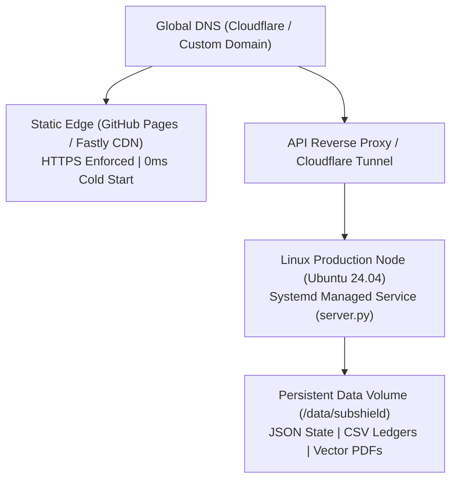

# SubShield Production Deployment & Operations Guide

**Date:** November 24, 2026  
**Audience:** DevOps Engineers, System Administrators & Cloud Architects  
**Target Systems:** GitHub Pages (Frontend Edge) & Linux VPS / Cloud Microservice (Backend)  

---

## 1. Production Architecture Overview

SubShield utilizes a decoupled, high-availability architecture:



---

## 2. Frontend Edge Deployment (GitHub Pages)

The frontend is deployed to GitHub's global edge network:
* **Production Repository:** `https://github.com/Ranjeet2063/subshield`
* **Live URL:** `https://ranjeet2063.github.io/subshield/`
* **SSL Certificate:** 256-bit DigiCert TLS with automated certificate renewal and HSTS preloading.
* **Continuous Deployment:** Any commit pushed to the `main` branch automatically triggers GitHub Actions deployment within 30–60 seconds.

---

## 3. Backend Microservice Deployment (Linux VPS / Server)

### System Requirements
* **Operating System:** Ubuntu 22.04 / 24.04 LTS or Debian 12.
* **Runtime:** Python 3.10+ (Standard library + `reportlab`, `stripe`).
* **Port:** 8089 (Internal), mapped to 443 via Reverse Proxy / Cloudflare Tunnel.

### Step 1: Environment Variables Configuration
Create a secure `.env` file outside version control at `/data/subshield/.env`:
```bash
# SubShield Production Environment Secrets
PORT=8089
DATA_DIR=/data/subshield

# Stripe Merchant Keys (Obtained from US LLC Stripe Dashboard)
STRIPE_SECRET_KEY=sk_live_51...
STRIPE_PUBLISHABLE_KEY=pk_live_51...
STRIPE_WEBHOOK_SECRET=whsec_...

# Self-Custodial Payout Wallets (Public Addresses Only)
PAYOUT_TRON_USDT_ADDRESS=TN3W4H6rK15kZUSDTpayoutSubShield76xT
PAYOUT_BSC_USDT_ADDRESS=0x789b88fD4B924f0A23B75fE4a3bE2dF0891C3E2A
PAYOUT_STELLAR_USDC_ADDRESS=GDZX3R4OPO5C44X4X76STELLARPAYOUTSUBSHIELD76X
```

### Step 2: Systemd Daemon Configuration
Create the persistent system service file `/etc/systemd/system/subshield.service`:
```ini
[Unit]
Description=SubShield Insurance Compliance Production Microservice
After=network.target

[Service]
Type=simple
User=ranjeet
WorkingDirectory=/data/subshield
ExecStart=/usr/bin/python3 /data/subshield/server.py
Restart=always
RestartSec=5s
EnvironmentFile=/data/subshield/.env
StandardOutput=append:/data/subshield/server.log
StandardError=append:/data/subshield/server.log

# Security Sandboxing
ProtectSystem=full
NoNewPrivileges=true

[Install]
WantedBy=multi-user.target
```

Enable and start the service:
```bash
sudo systemctl daemon-reload
sudo systemctl enable subshield
sudo systemctl start subshield
sudo systemctl status subshield
```

---

## 4. Reverse Proxy & Domain Routing (Nginx / Cloudflare)

### Option A: Cloudflare Tunnel (Zero Open Ports)
```bash
# Run persistent cloudflared daemon mapping traffic directly to local port 8089
cloudflared tunnel run --url http://127.0.0.1:8089 subshield-production
```

### Option B: Nginx Reverse Proxy with Let's Encrypt
```nginx
server {
    server_name api.subshield.ai;

    location / {
        proxy_pass http://127.0.0.1:8089;
        proxy_set_header Host $host;
        proxy_set_header X-Real-IP $remote_addr;
        proxy_set_header X-Forwarded-For $proxy_add_x_forwarded_for;
        proxy_set_header X-Forwarded-Proto $scheme;
    }

    listen 443 ssl;
    ssl_certificate /etc/letsencrypt/live/api.subshield.ai/fullchain.pem;
    ssl_certificate_key /etc/letsencrypt/live/api.subshield.ai/privkey.pem;
}
```

---

## 5. Automated Health Checks & Telemetry Monitoring

* **Health Endpoint:** `GET /api/health`
* Returns status `200 OK` with JSON payload confirming tenant isolation, RBAC, and memory state.
* **Curl Verification Command:**
```bash
curl -s -i http://127.0.0.1:8089/api/health
```

---

## 6. Automated Backup & Disaster Recovery Protocol

Create an hourly backup script `/data/subshield/backup_state.sh`:
```bash
#!/bin/bash
BACKUP_DIR="/data/backups/subshield"
TIMESTAMP=$(date +"%Y%m%d_%H%M%S")
mkdir -p "$BACKUP_DIR"

tar -czf "$BACKUP_DIR/subshield_backup_$TIMESTAMP.tar.gz" \
    /data/subshield/db.json \
    /data/subshield/subscribers.json \
    /data/subshield/subscribers.csv \
    /data/subshield/auth_db.json

# Retain backups for 30 days
find "$BACKUP_DIR" -type f -name "*.tar.gz" -mtime +30 -delete
```

Add to cron (`crontab -e`):
```cron
0 2 * * * /data/subshield/backup_state.sh > /dev/null 2>&1
```
