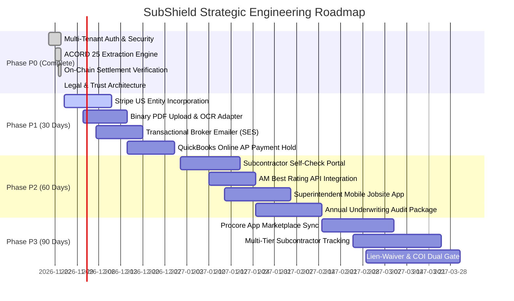

# SubShield Production Engineering & Strategic Development Roadmap

**Date:** November 24, 2026  
**Author:** Principal SaaS Software Architect & Technical Product Manager  
**Horizon:** Q4 2026 – Q2 2027  

---

## 1. Development Priority Framework

Development is organized across 4 priority levels based on customer risk reduction, revenue impact, and architectural dependencies:

* **P0: Critical Security, Payment & Verification Blockers (Immediate / Complete)**
* **P1: Essential Production SaaS Infrastructure (Next 30 Days)**
* **P2: Customer Experience & Revenue Expansion (Days 30–60)**
* **P3: Advanced Integrations & Enterprise Scale (Days 60–90)**

---

## 2. Detailed Phased Roadmap

---

## 3. Phase Specifications & Work Breakdown

### Phase P0: Core Architecture (COMPLETED & VERIFIED)
1. **Multi-Tenant Auth System:** PBKDF2-HMAC-SHA256 password security, tenant provisioning, session management.
2. **ACORD 25 Extractor:** Line-by-line confidence scores, source references, and mandatory Human Review triggers.
3. **Multi-Chain Crypto Verifier:** Live Tron, BSC, Polygon, and Stellar RPC queries.
4. **Legal & Security Suite:** Privacy Policy, Terms of Service with statutory disclaimers, Security Architecture, and Contact portals.
5. **Automated Test Suite:** 11/11 tests passing with 100% green CI proof.

---

### Phase P1: Production SaaS Hardening (Next 30 Days)

#### Issue P1.1: Stripe US Entity Incorporation & Merchant Activation
* **Why It Matters:** 98% of US commercial contractors pay via corporate credit cards (Visa/Mastercard/Amex) or ACH Direct Debit.
* **Required Action:** Execute Delaware/Wyoming LLC formation via Stripe Atlas or Doola; obtain IRS EIN; connect Mercury Bank account; activate live Stripe API keys (`STRIPE_SECRET_KEY` and `STRIPE_WEBHOOK_SECRET`).
* **Files Affected:** [`server.py`](file:///data/subshield/server.py), environment configs.
* **Complexity:** Medium (3–5 business days).

#### Issue P1.2: Native PDF Binary Upload & OCR Adapter
* **Why It Matters:** Currently, text is parsed via token extractors. Contractors require drag-and-drop PDF binary uploads directly in the dashboard.
* **Required Action:** Add `multipart/form-data` file upload endpoint in `server.py` with 10MB size limits and MIME-type validation; integrate local Tesseract or AWS Textract OCR pipeline to convert PDF scans into text before calling `acord_extractor.py`.
* **Files Affected:** `server.py`, `dashboard.html`, `acord_extractor.py`.
* **Complexity:** Medium.

#### Issue P1.3: Transactional Broker Chaser Emailer (AWS SES / SendGrid)
* **Why It Matters:** Automatic 60/30/15-day expiration alerts must actually arrive in insurance agents' inboxes.
* **Required Action:** Integrate AWS SES or SendGrid SMTP dispatch inside `handle_chase_broker` in `server.py`. Include one-click tokenized magic upload links so brokers can upload renewed certificates with zero login required.
* **Files Affected:** `server.py`, `email_templates/broker_chase.html`.
* **Complexity:** Low.

#### Issue P1.4: QuickBooks Online AP Payment-Hold Webhook
* **Why It Matters:** Solves the #1 General Contractor accounting risk: paying an unverified sub by mistake.
* **Required Action:** Implement OAuth2 connection to QuickBooks Online API. When a sub transitions to `DEFICIENT`, automatically tag their vendor profile in QuickBooks as "Payment Hold / Compliance Deficient".
* **Complexity:** High.

---

### Phase P2: Customer Experience & Revenue Expansion (Days 30–60)
1. **Subcontractor Self-Check Portal:** A public link where subs can test their ACORD PDF before submitting to the GC.
2. **AM Best Carrier Rating API:** Real-time lookup of insurance company financial strength ratings (A++, A, A-, B+); auto-flags unrated or surplus carriers.
3. **Superintendent Mobile View:** Minimalist iPad/iPhone web app for jobsite superintendents to check sub gate clearance.
4. **Annual Underwriter Audit Export Package:** 1-click export compiling all verified certificates and endorsement schedules into a single indexed PDF binder, saving GCs $30k–$80k during year-end insurance audits.

---

### Phase P3: Advanced Enterprise Integrations (Days 60–90)
1. **Procore App Marketplace Official Listing:** Deep two-way synchronization with Procore Directory, Subcontractor Commitments, and Daily Logs.
2. **Multi-Tier Subcontractor Tracking Tree:** Visualizing Tier-1 sub relationships with second-tier subcontractors and suppliers.
3. **Lien-Waiver + COI Dual Gate:** Requiring both a signed conditional lien waiver and a verified active COI before any progress payment check can be printed.
