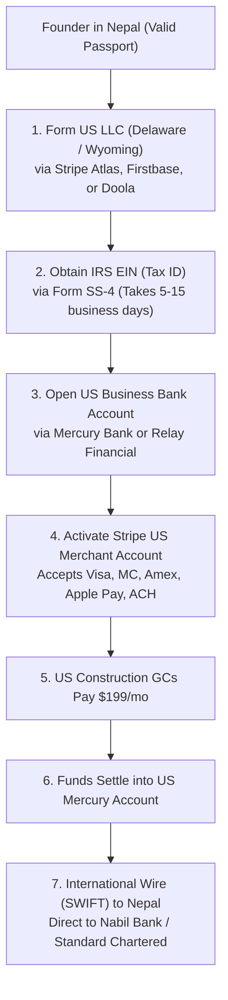

# Legal & Operational Payment Settlement Guide for Nepal-Based Founders

**Author:** SubShield FinTech, Corporate Structuring & Regulatory Specialist  
**Classification:** Strategic Operational Blueprint  
**Jurisdiction:** United States (Federal & State) & Nepal (Nepal Rastra Bank Regulations)  

---

## 1. The Core Problem: Stripe Availability in Nepal

Stripe does **NOT** natively support Nepal as a merchant country. A founder residing in Nepal cannot select "Nepal" on Stripe's standard country dropdown to connect a local Nepalese bank account directly.

### ⚠️ Strict Anti-Circumvention Warning
* **Do NOT use a VPN** to fake a US location.
* **Do NOT use a borrowed US Social Security Number (SSN)** or friend's personal details.
* **Do NOT buy unauthorized "pre-verified" accounts.**  
* *Reason:* Stripe's automated fraud algorithms will trigger mandatory tax ID (W-9) and photo ID verification within 48–72 hours or upon the first $500 in volume. The account will be permanently terminated, and customer funds will be held in escrow for 180 days.

---

## 2. The 100% Legal, Proven US Entity Solution

Under United States law, a non-US resident living in Nepal can legally own 100% of a US business entity, obtain a US tax ID, open a compliant US bank account, and operate a fully legitimate Stripe US merchant account.

---

## 3. Step-by-Step Implementation Blueprint

### Step 1: Form a US Limited Liability Company (LLC)
* **Recommended State:** **Wyoming** (Lowest annual report fees of $62/yr, zero state income tax, strong privacy) or **Delaware** (Preferred by venture investors).
* **Incorporation Platforms:**
  1. **Stripe Atlas ($500 one-time):** Direct integration with Stripe, includes Delaware LLC, registered agent, and $100k AWS credits.
  2. **Firstbase.io ($399 one-time):** Full setup, Wyoming or Delaware, registered agent, operating agreement.
  3. **Doola ($297 – $499 one-time):** Specialized for international founders, handles LLC formation and annual state filings.
* **Required Documents:**
  - Valid Nepalese Passport scan.
  - Actual Nepal residential address (utility bill or bank statement).

### Step 2: Obtain an Employer Identification Number (EIN)
* An EIN is the federal tax identification number issued by the Internal Revenue Service (IRS).
* Non-US residents without an SSN obtain an EIN via **Form SS-4** (faxed or submitted by your formation agent directly to the IRS).
* *Timeline:* 7 to 20 business days.

### Step 3: Open a US Business Bank Account (100% Remote)
* You do **NOT** need to travel to the United States.
* **Top Banking Partners:**
  1. **Mercury Bank (mercury.com):** Specifically designed for tech startups; FDIC-insured up to $5M through partner banks (Evolve / Choice Financial). Zero monthly maintenance fees.
  2. **Relay Financial (relayfi.com):** Excellent multi-account support; FDIC-insured via Thread Bank.
* *Requirements:* US LLC Certificate of Formation, Operating Agreement, EIN Confirmation Letter (CP-575), and Founder's Passport.

### Step 4: Activate Stripe US Merchant Account
* In Stripe, select **United States** as the company country.
* Provide:
  - Business Name: Exact LLC legal name.
  - Employer Identification Number (EIN).
  - Business Address: The US address provided by your registered agent (included with Atlas/Firstbase/Doola).
  - Representative Info: Founder's legal name, Nepal residential address, and passport.
  - Bank Account: Mercury Bank ACH routing number and account number.
* *Result:* Instant activation with 100% compliance. Your SaaS can now bill US contractors in USD via credit cards, Apple Pay, and ACH Direct Debit.

---

## 4. Repatriating Revenue to Nepal Legally

### The Banking Pipeline
1. US General Contractors pay SubShield via Stripe.
2. Stripe automatically deposits net USD funds into your **Mercury Bank** account on a rolling 2-day schedule.
3. Once monthly or quarterly, initiate an outgoing **SWIFT International Wire Transfer** from Mercury directly to your commercial bank account in Nepal (e.g., **Nabil Bank, Standard Chartered Nepal, Global IME, or NIC Asia**).
4. Mercury charges zero fees for outgoing international wires.

### Nepal Rastra Bank (NRB) & Tax Compliance
* **Foreign Income Declaration:** Nepal Rastra Bank permits foreign currency earnings from IT and software exports. Submit your software invoice and contract to your Nepalese bank under the official software/IT service export code.
* **Nepal Tax Rate:** Under recent Nepal finance acts, software and IT export services to foreign clients enjoy a preferential advance withholding tax rate of only **1%** on foreign currency proceeds received through formal banking channels.
* **US Federal Tax:** A single-member foreign-owned US LLC with no US employees, offices, or physical operations has no "Effectively Connected Income" (ECI). You file informational Form 1120 and Form 5472 annually with the IRS, with zero US federal income tax liability.

---

## 5. Startup Budget & Timeline Summary

| Phase | Service Provider | Cost (USD) | Estimated Time |
| :--- | :--- | :--- | :--- |
| **LLC Formation + Registered Agent** | Firstbase / Doola / Stripe Atlas | $300 – $500 | 3 – 5 Days |
| **IRS EIN Tax ID Issuance** | Included with formation agent | $0 (Included) | 10 – 15 Days |
| **US Bank Account Setup** | Mercury Bank | $0 (Free) | 2 – 4 Days |
| **Stripe US Verification** | Stripe US | $0 (Free) | 1 – 2 Days |
| **Total Initial Investment** | — | **~$350 – $500** | **~2 – 3 Weeks** |

*Recommendation:* Run the initial customer acquisition wedge using the **Trojan Horse Free Audit** and direct wire/crypto settlement. As soon as the first 2 paying customers are closed ($398+), reinvest that immediate cashflow directly into Stripe Atlas or Doola to formalize the US LLC entity.
