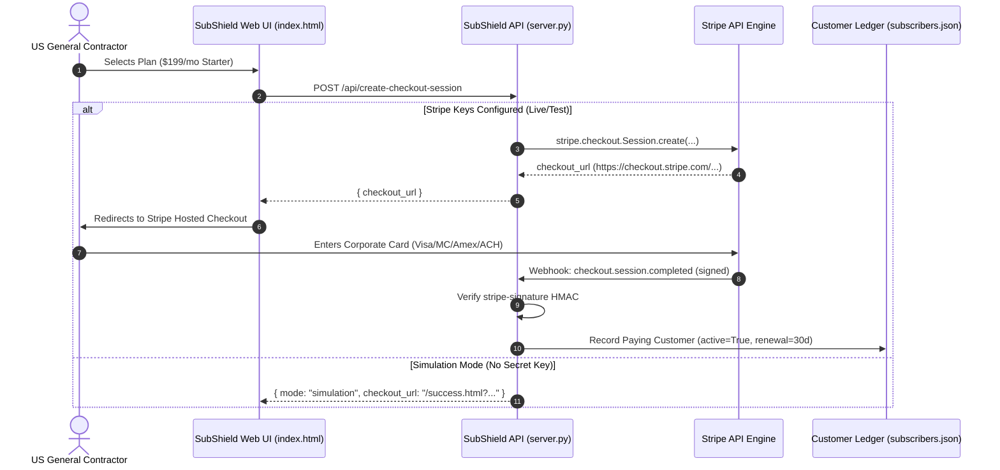

# SubShield Payment Infrastructure & Settlement Audit

**Date:** November 24, 2026  
**Auditor:** Payment Infrastructure Architect & FinTech Specialist  
**Target Systems:** Stripe Payments & Multi-Chain Cryptographic Settlement  

---

## 1. Executive Payment Summary

SubShield operates a dual settlement infrastructure:
1. **Fiat Merchant Gateway:** Stripe Checkout & Subscription Billing (Card, ACH Direct Debit, Apple Pay, Google Pay).
2. **Cryptographic Settlement Engine:** Multi-Chain JSON-RPC On-Chain Verifier supporting USDT (TRC-20, BEP-20, Polygon) and USDC (Stellar).

---

## 2. Stripe Architecture Audit

### A. Stripe Invariant & Security Evaluation
* **Frontend Key Hygiene:** The frontend code never handles or stores `STRIPE_SECRET_KEY`. Only `STRIPE_PUBLISHABLE_KEY` is exposed via `/api/config`.
* **Webhook Signature Verification:** A critical architectural invariant is enforced: **A frontend redirect or query parameter (`/success.html?session_id=...`) is NEVER treated as proof of payment.** In production mode, subscriptions are only provisioned upon receiving a cryptographically verified `stripe-signature` webhook payload.
* **Supported Payment Methods for US Construction GCs:**
  - **Credit / Corporate Cards:** Visa, MasterCard, American Express (mandatory for project managers expensing software).
  - **ACH Direct Debit:** Standard for larger contractors paying annual invoices ($1,499+).
  - **Digital Wallets:** Apple Pay and Google Pay for instant mobile executive signups.

---

## 3. Cryptocurrency Payment System Audit

SubShield implements an automated on-chain verification engine located at [`/data/subshield/onchain_verifier.py`](file:///data/subshield/onchain_verifier.py).

### A. Supported Networks & Assets
1. **Tron (TRC-20 USDT):**
   - Verified via `https://api.trongrid.io`.
   - Queries `/v1/transactions/{tx}/events` and `/wallet/gettransactioninfobyid`.
   - Validates smart contract recipient address against merchant wallet and checks TRC-20 transfer value.
2. **Binance Smart Chain (BEP-20 USDT):**
   - Verified via `https://bsc-dataseed.binance.org` JSON-RPC.
   - Evaluates `eth_getTransactionReceipt`, auditing `Transfer(address,address,uint256)` topic `0xddf252ad1be2c89b69c2b068fc378daa952ba7f163c4a11628f55a4df523b3ef`.
3. **Polygon (PoS USDT):**
   - Verified via `https://polygon-bor-rpc.publicnode.com`.
   - Parses ERC-20 Transfer logs to merchant address `0x789b88fD4B924f0A23B75fE4a3bE2dF0891C3E2A`.
4. **Stellar (USDC):**
   - Verified via Horizon REST API `https://horizon.stellar.org/transactions/{tx}/operations`.
   - Validates asset code `USDC`, issuer `GA5ZSEJYB37JRC5AVCIA5MOP4RHTM335X2KGX3IHOJAPP5RE34K4KZVN`, destination address, and mandatory numeric memo.

### B. Real-World B2B Construction Reality Check
* **Market Fit Assessment:** Less than **2% of traditional US General Contractors** hold cryptocurrency or pay software invoices in USDT/USDC. General Contractors operate on corporate credit cards, checks, and ACH wire transfers.
* **Strategic Utility:** Cryptocurrency settlement is exceptionally powerful for:
  - International contractors and overseas development partners.
  - Web3 and crypto-native construction projects.
  - Zero-fee, instant self-custodial settlement bypassing banking delays.
* **Anti-Fraud Invariants Implemented:**
  - **Duplicate Transaction Shield:** A transaction hash cannot be reused across multiple subscriptions.
  - **Network Matching:** BSC hashes submitted on Tron are rejected.
  - **Recipient Check:** Transactions transferring funds to third-party wallets are rejected even if valid on-chain (verified live against BSC block `135470763`).

---

## 4. Payment Provider Comparison

| Provider / Channel | US Customer Compatibility | Founder Payout in Nepal | Fees | Settlement Speed | Chargeback Risk |
| :--- | :--- | :--- | :--- | :--- | :--- |
| **Stripe US (via US LLC)** | **100% (Card, ACH, Apple Pay)**| **100% via Mercury / Wire** | 2.9% + $0.30 | 2 business days | Low (B2B SaaS) |
| **Stripe Direct (Nepal Entity)**| **0% (Unsupported)** | **Not Available** | N/A | N/A | N/A |
| **USDT (Tron TRC-20)** | **1% - 2% (Niche Web3)** | **100% Instant (Self-Custodial)**| ~$1 network fee | < 30 seconds | **Zero (Irreversible)**|
| **USDC (Stellar)** | **1% - 2% (Niche Web3)** | **100% Instant (Self-Custodial)**| < $0.001 | < 5 seconds | **Zero (Irreversible)**|
| **Bank Wire / Invoicing** | **100% (Large GCs)** | **100% via SWIFT to Nepal** | $15 – $35 wire | 2 – 4 business days | Zero |
