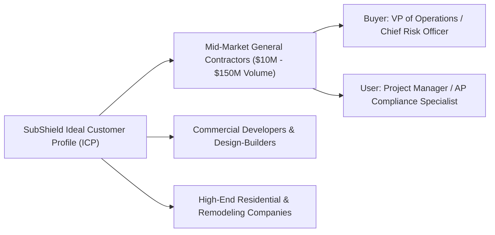

# United States Construction Insurance Compliance Market Research

**Date:** November 24, 2026  
**Focus:** US Commercial Construction, General Contractors (GCs), and ACORD 25 Insurance Verification  
**Author:** SubShield US Market Research & B2B Strategy Group  

---

## 1. Executive Industry Overview

The United States construction sector accounts for over **$2.1 Trillion in annual spending**, comprising more than **750,000 contractor businesses**. Approximately **82% of all commercial construction work is executed by specialty subcontractors** (framing, roofing, electrical, mechanical, concrete, masonry, plumbing).

In the US legal landscape, construction contracts strictly mandate **Risk Transfer**:
> A General Contractor agrees to build a project on the condition that any physical injury, property defect, or third-party lawsuit caused by a trade subcontractor is indemnified by that subcontractor's insurance carrier.

However, in practice, **over 70% of subcontractor Certificates of Insurance (COI) in circulation contain critical coverage defects, missing endorsements, or lapsed dates**, exposing General Contractors to catastrophic first-dollar legal liability.

---

## 2. Target Customer Personas

### Persona 1: The Risk Manager / VP of Operations
* **Company Size:** $25M – $100M annual project volume (managing 40 – 120 subcontractors simultaneously).
* **Core Pain:** Terrified that a jobsite catastrophe (crane collapse, severe worker injury, water damage) will result in a claim denial because a project coordinator filed an invalid ACORD 25.
* **Economic Impact:** A single severe injury without an Additional Insured endorsement results in a direct loss of **$500,000 to $2,500,000+** from the GC's pocket and a 40% hike in their master liability policy.

### Persona 2: The Accounts Payable (AP) Controller / Project Administrator
* **Role:** Administering weekly subcontractor progress payments and lien waivers.
* **Core Pain:** Wasting **15 to 20 hours per week** chasing insurance agents via phone and email, reviewing 4-page ACORD PDFs manually, and getting yelled at by superintendents for holding checks when subs are non-compliant.

### Persona 3: The Trade Subcontractor Broker / Agent
* **Role:** Commercial insurance agent issuing ACORD certificates for electrical, roofing, and plumbing contractors.
* **Core Pain:** Spending endless hours re-issuing certificates because the GC's requirements changed or their certificate got lost in an email spam folder.

---

## 3. The 14 Critical Business Problems in COI Management

1. **ACORD 25 False Security:** General Contractors assume that possessing a piece of paper labeled "ACORD 25" means they are protected. In reality, standard ACORD certificates state in bold caps that they confer no rights and do not amend the underlying policy.
2. **Missing CG 20 10 & CG 20 37 Endorsements:** GCs require coverage for both *Ongoing Operations* (accidents while working) and *Completed Operations* (structural failures 3 years later). Over 60% of submitted certificates only check the ongoing box, leaving completed operations entirely unbacked.
3. **Waiver of Subrogation (WOS) Omission:** Without an explicit WOS endorsement, if a subcontractor's employee is injured and collects Workers' Comp, their insurance carrier can sue the General Contractor to recover payouts.
4. **Primary and Non-Contributory Clause Gaps:** Without this endorsement, the subcontractor's carrier forces the General Contractor's insurer to contribute equally to claim defense.
5. **Mid-Project Coverage Cancellation:** An estimated **18% of trade subcontractors cancel or default on monthly premium payments** 30–60 days after contract signing, leaving active jobsites completely uninsured.
6. **Underfunded Umbrella / Excess Limits:** Commercial contracts standardly require $5,000,000 in excess liability. Small subcontractors frequently carry only $1,000,000, exposing the GC to catastrophic shortfall.
7. **Broker Communication Chokepoints:** Project managers send emails into a void; brokers take 3–5 business days to reply, delaying jobsite mobilization.
8. **Insolvent Surplus Lines Carriers:** Subcontractors in high-risk trades (roofing, demolition) often buy cheap policies from unrated or B-rated carriers that go insolvent during litigation.
9. **Accounting Desynchronization:** AP departments release checks in QuickBooks/Procore without checking if the sub's insurance expired 2 days ago.
10. **Multi-Tier Subcontracting Exposure:** A prime electrical subcontractor subcontracts conduit installation to a second-tier contractor who has zero insurance.
11. **Cancellation Notice Disclaimers:** Standard ACORD certificates state the insurer will "endeavor to" notify the certificate holder, which courts have repeatedly ruled imposes zero legal duty on the carrier to notify the GC of cancellation.
12. **Monopolistic State Workers' Comp Confusion:** Subcontractors operating in Ohio, Washington, North Dakota, or Wyoming must purchase Workers' Comp through state funds; standard private ACORD certificates in these states are invalid.
13. **Document Discovery Vulnerability:** When lawsuits arise 4 years post-construction, paper certificates are missing or water-damaged, causing immediate summary judgment against the GC.
14. **Annual Underwriting Premium Audits:** At the end of every year, the GC's own insurance underwriter audits all subcontractor records. Any subcontractor without a verified certificate results in the GC being charged a penalty premium (often **$30,000 – $80,000** back-charged).

---

## 4. Twenty Prioritized Product Opportunities for SubShield

| # | Product Opportunity | Customer Demand | Revenue Impact | Complexity | Priority |
| :- | :--- | :--- | :--- | :--- | :--- |
| **1** | **Free Instant 5-COI Audit Wedge** | **CRITICAL** | High (Primary Top-of-Funnel Conversion) | Low | **P0** |
| **2** | **Automated 60/30/15-Day Broker Magic Links** | **CRITICAL** | High (Eliminates PM Phone Time) | Low | **P0** |
| **3** | **Confidence-Scored ACORD OCR + Human Review Queue**| **CRITICAL** | High (Prevents Claim Denials) | Medium | **P0** |
| **4** | **QuickBooks & Procore AP Payment-Hold Webhook** | **HIGH** | High (Guarantees Sub Compliance) | Medium | **P1** |
| **5** | **Direct Multi-Network Crypto & US Card Settlement** | **MEDIUM** | High (Instant Self-Custodial Cashflow) | Medium | **P1** |
| **6** | **Subcontractor Self-Check Portal (Pre-Submission)** | **HIGH** | Medium (Reduces Re-Submissions) | Low | **P1** |
| **7** | **ISO Endorsement Verification Form Matcher (CG 20 10)**| **HIGH** | High (Verifies Actual Endorsement PDF)| High | **P1** |
| **8** | **Waiver of Subrogation Endorsement Check (CG 24 04)** | **HIGH** | Medium (Eliminates Carrier Lawsuits) | Medium | **P1** |
| **9** | **Per-Project Aggregate Limit Tracker (CG 25 03)** | **MEDIUM** | Medium (Prevents Exhaustion on Other Jobs)| Medium | **P2** |
| **10**| **AM Best Carrier Rating Live API Verification** | **MEDIUM** | High (Blocks Fly-by-Night Carriers) | Low | **P2** |
| **11**| **Jobsite Superintendent Mobile Clearance View** | **HIGH** | Medium (Enforces Gate Security) | Low | **P2** |
| **12**| **One-Click Deficiency Letters to Broker** | **HIGH** | Medium (Standardizes Legal Language) | Low | **P2** |
| **13**| **Multi-Tier Subcontractor Tracking Tree** | **MEDIUM** | High (Enterprise Tier Lock-in) | High | **P2** |
| **14**| **Automated Annual Underwriter Audit Export Package**| **HIGH** | High (Saves $50k+ in Audit Penalties) | Medium | **P2** |
| **15**| **Statutory Monopolistic Workers' Comp State Rules**| **MEDIUM** | Low (Eliminates Regional Fines) | Low | **P3** |
| **16**| **Conditional & Unconditional Lien Waiver Gate** | **HIGH** | High (Full Risk & AP Coverage) | Medium | **P3** |
| **17**| **Broker-to-Broker Collaborative Remediation Chat** | **LOW** | Low (Reduces Email Noise) | High | **P3** |
| **18**| **AI Cancellation Notice Clause Striker** | **LOW** | Low (Replaces 'Endeavor' Wording) | Medium | **P3** |
| **19**| **Self-Custodial Web3 Settlement for Tech Builders** | **LOW** | Medium (Niche Strategic Revenue) | Low | **P3** |
| **20**| **Per-Sub Usage-Based Micro-Billing ($10/sub/mo)** | **HIGH** | High (Expands to Small 5-Sub GCs) | Medium | **P3** |
